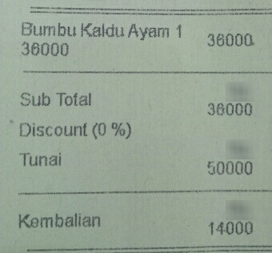

# Receipt field extraction on CORD-v2: does layout help?

[](https://github.com/yuiandyuki/receipt-extraction-cord/actions/workflows/ci.yml)

Given the OCR words of a receipt (text + box per word), tag which words are the item names, prices,
subtotal, tax, total, cash, change, ... — the step after OCR in an AI-OCR bookkeeping flow, where a
photographed receipt becomes a journal-entry candidate. I compare a **text-only** model
(`xlm-roberta-base`, sees only the words) with a **layout-aware** model (`microsoft/layoutlmv3-base`,
sees words + coordinates + the image) and a **regex rule baseline** for the total, and test whether the
difference is statistically meaningful on the 100-receipt test set.

## Results

Test set (100 receipts, 1,301 entities), entity-level F1, seed 42. Brackets: 95% CI from a receipt-level bootstrap.
All numbers come from `results/` and are printed by `python -m receipt.report`.

| Field | Support | Rule baseline | Text (XLM-R) | Layout (LayoutLMv3) |
|---|---:|---:|---:|---:|
| **micro (all fields)** | 1301 | – | 0.942 [0.918, 0.963] | 0.949 [0.929, 0.967] |
| `menu.nm` | 251 | – | 0.929 | 0.937 |
| `menu.cnt` | 220 | – | 0.979 | 0.977 |
| `menu.price` | 246 | – | 0.958 | 0.980 |
| `menu.unitprice` | 67 | – | 0.859 | 0.933 |
| `sub_total.subtotal_price` | 66 | – | 0.932 | 0.970 |
| `sub_total.tax_price` | 44 | – | 1.000 | 0.989 |
| `total.total_price` | 95 | 0.904 [0.845, 0.957] | 0.969 [0.938, 0.995] | 0.979 [0.951, 1.000] |
| `total.cashprice` | 69 | – | 0.978 | 0.932 |
| `total.changeprice` | 56 | – | 0.991 | 0.991 |

Paired comparisons on test (difference in F1, 95% bootstrap CI, two-sided paired permutation test, 10,000 resamples each):

| Comparison | Scope | Difference | p |
|---|---|---:|---:|
| Layout − Text | micro | +0.008 [-0.004, +0.021] | 0.2083 |
| Layout − Text | total.total_price | +0.010 [+0.000, +0.026] | 0.4945 |
| Text − Baseline | total.total_price | +0.064 [+0.013, +0.122] | 0.0099 |
| Layout − Baseline | total.total_price | +0.075 [+0.027, +0.131] | 0.0065 |

Training runs (Apple M3 laptop, PyTorch MPS backend, torch 2.14.1, transformers 5.20.2):

| Run | Device | Train time | Best epoch | Validation micro F1 | Test micro F1 |
|---|---|---:|---:|---:|---:|
| layout_seed42 | mps: Apple M3 | 114.0 min | 15 | 0.9632 | 0.9494 |
| text_seed42 | mps: Apple M3 | 29.1 min | 12 | 0.9550 | 0.9415 |

Per-field rows are point estimates only; fields not shown are in `results/metrics/*.json`. Rare fields have very few
test entities, so their F1 can swing a lot from one or two mistakes.

### What the results say

<!-- TODO(Sihao): draft written by Claude Code; rewrite this section in your own words. -->

- **Both models beat the rule on the total by a clear margin** (+0.06 to +0.07 F1). The intervals exclude 0 and p < 0.01.
  The rule is already strong (0.90): in this word order the amount usually comes right after the `TOTAL` word.
- **The layout model scored higher overall (0.949 vs 0.942), but this test set cannot tell them apart.** The difference
  is +0.008, its 95% CI [−0.004, +0.021] contains 0, and p = 0.21. That is "no evidence of a difference", not
  "evidence of no difference".
- The fields where layout looked better are the ones where **column position carries the meaning**: unit price vs line
  price (0.933 vs 0.859 on `menu.unitprice`) and subtotal. These per-field gaps were not tested and rest on 66–67 test entities each.
- **On the total, the two models differ on only 2 of the 100 receipts.** Both are text-model false positives. The
  bootstrap CI of the difference starts at exactly 0, because layout is never worse on any resample. But a
  difference that comes from 2 receipts is weak evidence, and the permutation test says so (p = 0.49).
- The layout model was still improving at the last epoch (best epoch = 15), so with the same 15-epoch budget it may be
  slightly under-trained. Giving both models more epochs is a fair next experiment.

### An error example

Test receipt `image_id=9`. The OCR word order is `Bumbu Kaldu Ayam 1`, `36000`, `36000`, `Sub`, `Total`, `36000`, …



| Word | Gold | Text model | Layout model |
|---|---|---|---|
| Bumbu Kaldu Ayam 1 | B-menu.nm | B-menu.nm | B-menu.nm |
| 36000 (right column) | **B-menu.price** | B-menu.unitprice ✗ | B-menu.price |
| 36000 (left, under the name) | **B-menu.unitprice** | B-menu.price ✗ | B-menu.unitprice |
| Sub / Total | O / O | O / O | O / O |
| 36000 | **B-sub_total.subtotal_price** | B-total.total_price ✗ | B-sub_total.subtotal_price |
| Tunai / 50000 | O / B-total.cashprice | ✓ | ✓ |
| Kembalian / 14000 | O / B-total.changeprice | ✓ | ✓ |

- **Unit price vs price.** The two `36000` words are identical strings next to each other in the sequence. Only
  their position tells them apart: the line price is in the right-hand column, the unit price is under the item
  name. The text model has no access to that and swaps them; the layout model gets both right.
- **Subtotal called total.** This receipt has no separate grand-total line. The text model tags `36000` after
  `Sub Total` as the total, probably keying on the word `Total` just before it. That is one of the two receipts behind the text model's lower `total.total_price` score.

Both models still make mistakes on less common fields. On test receipt 85, the lines `Ttl Makanan 159.500` /
`Ttl Minuman 20.000` (food / drink subtotals, gold `sub_total.etc`, 111 training examples) are mislabelled: the text
model tags `20.000` as `total.total_price`, and the layout model tags the two amounts as `total.total_etc` and
`total.emoneyprice`.

## How it works

```
CORD-v2 ground_truth (JSON)                    src/receipt/data.py
  valid_line[i].category, words[j].text/quad/is_key
        │  one line = one entity; B- on first word, I- on the rest; key words ("TOTAL") -> O
        ▼
word-level sequence: words, pixel boxes, BIO tags (59 labels = O + B/I x 29 fields)
        │  boxes -> 0-1000 grid (layout model only); image -> 224x224 pixel_values
        ▼
sub-word tokens (XLM-R / LayoutLMv3 tokenizer)  src/receipt/encode.py
        │  only the first sub-token of each word carries the label, the rest -100
        ▼
token classification fine-tuning (HF Trainer)   src/receipt/train.py
        │  each word takes its first sub-token's prediction
        ▼
word-level predicted tags -> entities           src/receipt/evaluate.py, bio.py
        │  seqeval: an entity is correct only if field AND exact word span match
        ▼
micro / per-field P, R, F1; receipt-level bootstrap + permutation test   src/receipt/stats.py
```

### Data

[CORD-v2](https://huggingface.co/datasets/naver-clova-ix/cord-v2) has Indonesian restaurant and shop receipts,
800 train / 100 validation / 100 test. Each annotated line has a category (e.g. `menu.nm`, `total.total_price`)
and words, each with a quadrilateral box. I use the dataset's own OCR words and boxes.

I printed samples before writing the converter. How the data compared with the plan:

- The structure matched: `valid_line` → `category` + `words` with `text` / `quad`; the image size is in `meta.image_size`.
- **Key words sit inside the value's line.** A `total.total_price` line is, for example, `Grand(key) Total(key) 1,591,600`.
  I tag leading and trailing key words `O`, so the entity is the amount itself. That is what bookkeeping needs and what
  the rule baseline outputs. `include_keys=True` gives the conventional labelling instead. Because of this choice, my
  numbers are not directly comparable with published CORD F1 scores.
- 29 categories occur, and all of them appear in train. 19 words have boxes slightly outside the image, so boxes are clipped.
- Receipts are short: median 20 words, at most 296 tokens, so no receipt is truncated at 512 tokens.
  [`notebooks/eda.ipynb`](notebooks/eda.ipynb) has the field counts: three menu fields make up most entities,
  and several fields have fewer than 10 training examples.

### Models and training

| | Text model | Layout model |
|---|---|---|
| Checkpoint | `FacebookAI/xlm-roberta-base` (278M params, MIT) | `microsoft/layoutlmv3-base` (126M params, CC-BY-NC-SA 4.0) |
| Input | words | words + boxes (0–1000) + 224×224 image |
| Settings | 15 epochs, batch 8, AdamW lr 5e-5, weight decay 0.01, 10% linear warm-up, max 512 tokens, seed 42 | same |

The best epoch is picked by validation micro F1. The test set is evaluated exactly once, after training.

### Statistics

- **Metric**: entity-level micro F1 (seqeval, BIO, default mode). A field value is useful only if the whole value
  is right. A token-level score would overstate quality, and most of it would come from the many `O` tokens.
- **Bootstrap by receipt**: resample the 100 test receipts with replacement, 10,000 times. Each time, re-sum TP / FP / FN
  over the sampled receipts and recompute micro F1. The 2.5th and 97.5th percentiles give the 95% CI for each model
  and for *layout − text*. Both models are scored on the same resampled receipts, so the difference is paired.
- **Paired permutation test**: the null hypothesis H0 is that the two models are interchangeable. On each receipt,
  swap the two models' predictions with probability 0.5 and recompute the F1 difference; repeat 10,000 times.
  The two-sided p is the share of permuted |differences| at least as large as the observed one.
- **Why receipts, not words**: words on one receipt are not independent. A blurry or unusual receipt causes many errors
  at once. Resampling words would pretend we have thousands of independent observations, and the intervals would come
  out far too narrow. The receipt is the independent unit.
- With only 100 test receipts the intervals are wide (about ±0.02 on micro F1), so a gap smaller than that cannot be
  separated from noise.

## Design decisions

- **Use the dataset's OCR** rather than training OCR. The question here is field extraction given OCR output; OCR
  quality is a separate problem and is listed as a limitation below.
- **Same training settings for both models**, so the comparison is about the input (with or without layout), not tuning.
- **First-sub-token labelling**: one prediction per word, which is what the API returns.
- **Rule baseline only for `total.total_price`**: it is the one field a simple rule can target (keyword + amount),
  and it shows what the models add over a few lines of regex. I wrote the rule by looking at train and validation only.
- **Key words tagged `O`**: see Data.

## Known limitations

- The test set is small (100 receipts), so confidence intervals are wide, and rare fields have only a few test entities.
- One seed per model: the variance across seeds is not measured.
- Only Indonesian restaurant and shop receipts; no Japanese receipts, no invoices.
- The dataset's own (clean) OCR is used. A real OCR engine would make word errors and produce a different **reading
  order**. Here words come in annotation order, grouped by line, which is easier than real OCR output. That probably
  helps the text-only model more, since it has no other way to know which words belong together.
- The layout model's best epoch was the last one (15), so it may not have converged within the shared budget.

## Reproduce

```bash
uv venv --python 3.11 .venv && source .venv/bin/activate   # or python3.11 -m venv .venv
pip install -r requirements-dev.txt && pip install --no-deps -e .
pytest -q

python -m receipt.train --model text   --seed 42   # -> results/metrics/text_seed42.json, runs/text_seed42/best/
python -m receipt.train --model layout --seed 42
python -m receipt.baseline                          # -> results/metrics/baseline.json
python -m receipt.stats \
  --system text=results/predictions/text_seed42_test.json \
  --system layout=results/predictions/layout_seed42_test.json \
  --system baseline=results/predictions/baseline_test.json \
  --out results/stats.json                          # bootstrap / permutation seed 0
python -m receipt.report                            # the tables above
```

- **Machine**: Apple M3 laptop, PyTorch MPS, Python 3.11.15, torch 2.14.1, transformers 5.20.2. Each
  `results/metrics/*.json` records the machine, library versions and training time.
- **Time**: text model 29 min, layout model 114 min. The layout run slowed from about 1.6 s/step in a short timing run
  to about 4–7 s/step for most of the run. The cause was not checked; likely candidates are thermal throttling or other load on the laptop.
- **Determinism**: `baseline`, `stats` and `report` are deterministic given the files in `results/`. Training uses fixed
  seeds, but GPU/MPS kernels are not bit-for-bit deterministic, so a re-run may differ in the last digits.
- **On Google Colab**: open [`notebooks/train_colab.ipynb`](notebooks/train_colab.ipynb) with a GPU runtime and run all cells.

## API

`POST /parse` takes multipart form data with two parts:

- `image`: the receipt image
- `ocr`: JSON `{"words": [...], "boxes": [[x0, y0, x1, y1], ...]}`, in pixel coordinates of that image

It returns the extracted fields with their word indices. Whichever model is in `model/` is served; the layout model
uses the image, the text model ignores it.

```bash
docker build -t receipt-api .
docker run --rm -v "$(pwd)/model:/app/model" -p 8000:8000 receipt-api
curl -s -F image=@examples/receipt.jpg -F "ocr=<examples/ocr.json" localhost:8000/parse
```

Output with the layout model on `examples/` (CORD validation receipt 0, about 0.4 s on CPU):

```json
{"model_type": "layoutlmv3", "fields": [
  {"field": "menu.cnt", "text": "1", "word_indices": [0]},
  {"field": "menu.nm", "text": "REAL GANACHE", "word_indices": [1, 2]},
  {"field": "menu.price", "text": "16,500", "word_indices": [3]},
  {"field": "menu.cnt", "text": "1", "word_indices": [4]},
  {"field": "menu.nm", "text": "EGG TART", "word_indices": [5, 6]},
  {"field": "menu.price", "text": "13,000", "word_indices": [7]},
  {"field": "menu.cnt", "text": "1", "word_indices": [8]},
  {"field": "menu.nm", "text": "PIZZA TOAST", "word_indices": [9, 10]},
  {"field": "menu.price", "text": "16,000", "word_indices": [11]},
  {"field": "total.total_price", "text": "45,500", "word_indices": [13]},
  {"field": "total.cashprice", "text": "50,000", "word_indices": [15]},
  {"field": "total.changeprice", "text": "4,500", "word_indices": [17]}
]}
```

### Getting `model/`

Weights are not in git. Retrain, then copy the run with the better **validation** score (here the layout model):

```bash
python -m receipt.train --model layout --seed 42
cp -r runs/layout_seed42/best model
```

## Repository layout

```
src/receipt/   data.py (CORD -> BIO)  encode.py (tokenise/align)  train.py  evaluate.py  bio.py
               baseline.py (regex)  stats.py (bootstrap/permutation)  report.py  api.py (FastAPI)
notebooks/     eda.ipynb  train_colab.ipynb
tests/         BIO conversion, boxes, statistics on synthetic data, API with a tiny random model
results/       metrics/*.json, predictions/*.json, stats.json
examples/      one CORD validation receipt for the API demo
docs/          error-example image (crop of CORD test receipt 9)
```

## Licenses

- **Data**: CORD-v2, CC-BY-4.0 — Park et al., *CORD: A Consolidated Receipt Dataset for Post-OCR Parsing*, Document
  Intelligence Workshop at NeurIPS 2019. `examples/`, `docs/` and `results/predictions/` contain CORD words and images.
- **LayoutLMv3 weights are CC-BY-NC-SA 4.0 (non-commercial)**. The fine-tuned layout model therefore may not be used
  commercially; a product would need a commercially licensed layout model. XLM-RoBERTa is MIT.
